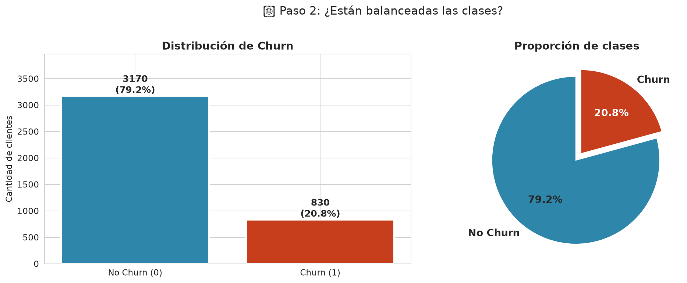
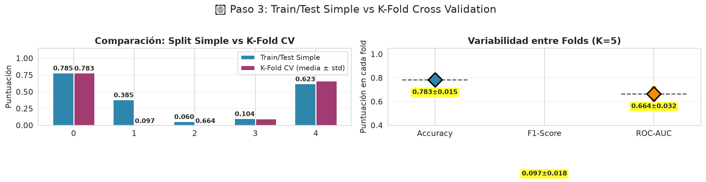
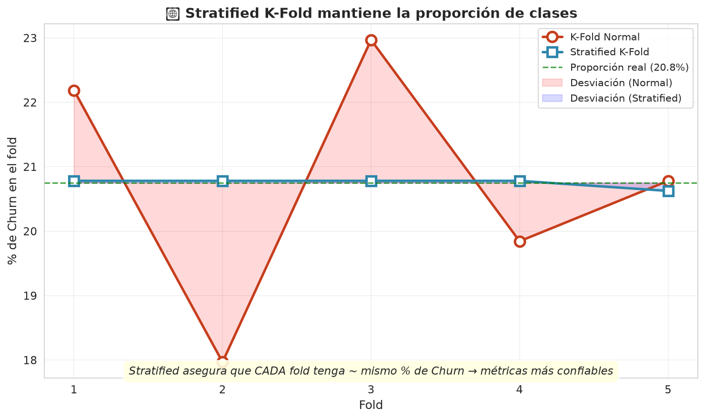
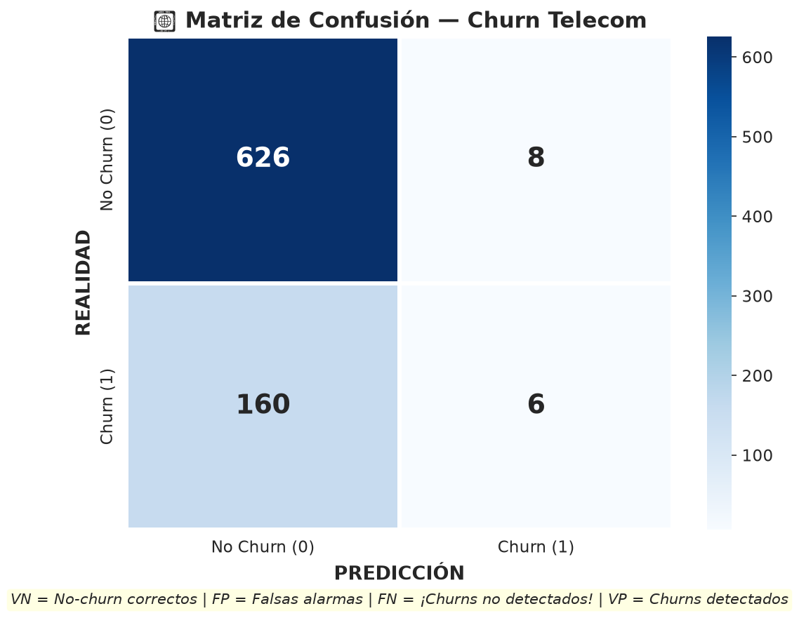
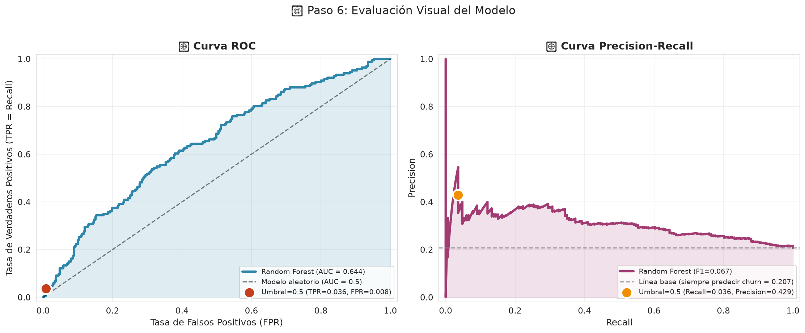
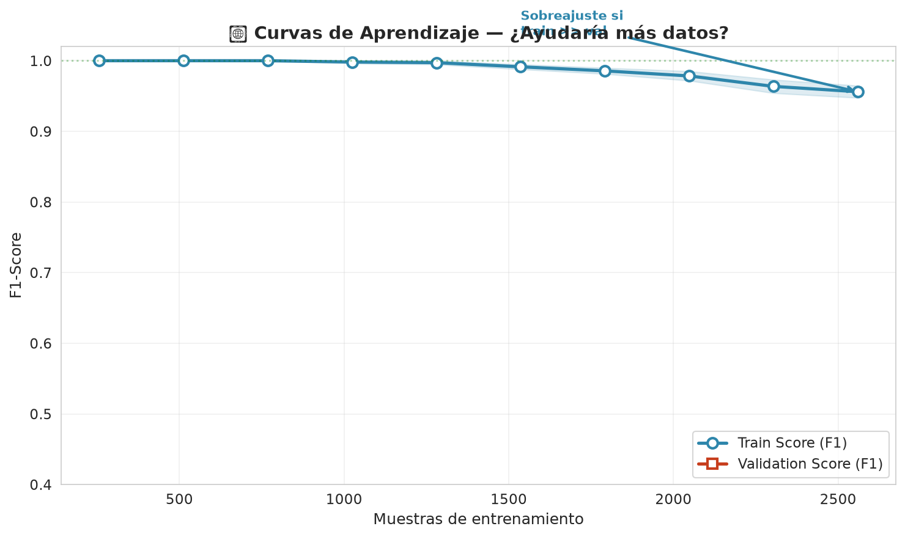
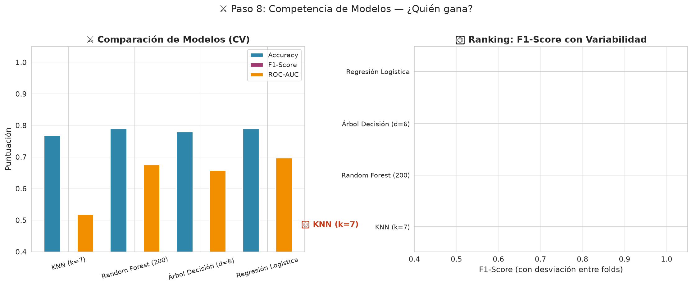
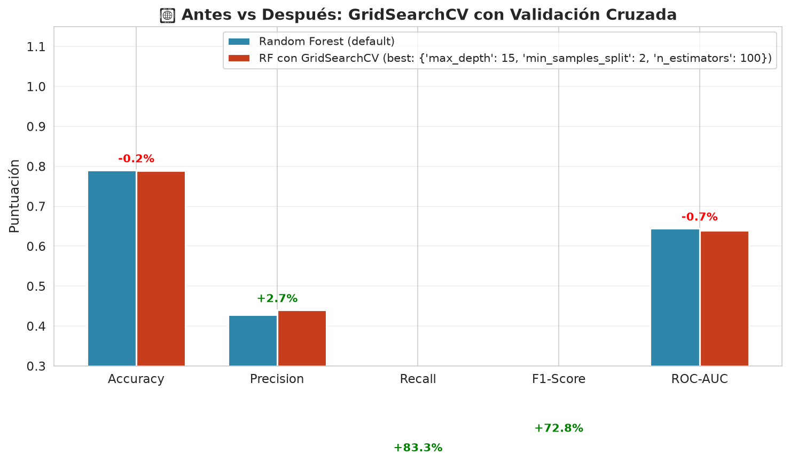

# 🎯 Validación Cruzada y Métricas Avanzadas — Telecom Churn Prediction

**Nivel:** 3 — ML Clásico (scikit-learn)
**Skill:** Validación Cruzada, Métricas para datos desbalanceados, Curvas de Aprendizaje, GridSearchCV
**Dataset:** Telecom Customer Churn (4,000 clientes simulados con patrones realistas)

---

## 📖 Qué vas a aprender

En los proyectos anteriores aprendiste a entrenar modelos (Regresión Lineal, KNN, Árboles, Random Forest). Pero hay un problema: **¿cómo saber si tu modelo realmente funciona bien?**

Hasta ahora usabas un simple `train_test_split` (80% entrenar, 20% probar). ¿Qué pasa si esa partición tuvo "suerte" y el modelo rinde peor en datos nuevos? La solución se llama **Validación Cruzada (Cross-Validation)**.

### Los 4 grandes conceptos de HOY:

### 1. K-Fold Cross Validation
En vez de partir los datos una sola vez, los **partimos en K partes** (típicamente 5). Entrenamos el modelo K veces, cada vez con K-1 partes y validamos con la parte restante. La métrica final es el **promedio** de los K resultados. Esto da una estimación **mucho más confiable** del rendimiento real.

### 2. Stratified K-Fold
Cuando una clase es minoritaria (como Churn, ~20%), el K-Fold normal puede generar algún fold **sin ejemplos de churn**. Stratified K-Fold **mantiene la misma proporción de clases** en cada fold. Es el estándar para clasificación con desbalanceo.

### 3. Métricas que importan
- **Accuracy**: fácil de engañar. Si hay 80% No-Churn, decir "nadie se va" da 80% de accuracy... pero no detecta ningún churn.
- **Precision**: de los que predije como churn, ¿cuántos realmente se fueron?
- **Recall**: de los que realmente se fueron, ¿cuántos detecté?
- **F1-Score**: media armónica de Precision y Recall. La métrica estrella.
- **ROC-AUC**: capacidad del modelo para separar las clases.

### 4. Curvas de Aprendizaje y GridSearchCV
- **Learning Curves**: muestran si el modelo sobreajusta, subajusta, o si más datos ayudarían.
- **GridSearchCV**: busca la mejor combinación de hiperparámetros **usando CV** para evaluar cada combinación. Así no hacemos trampa (nunca usamos el test set para elegir parámetros).

---

## 🧪 Código paso a paso

El proyecto completo está en `project.py`. Aquí te explico cada sección:

### Paso 1: Generar datos realistas de churn
Creamos 4,000 clientes simulados con patrones del mundo real:
- **Contratos mes a mes**: 3× más probabilidad de irse (la gente cancela rápido)
- **Fibra óptica**: más churn por competencia
- **Antigüedad (tenure)**: clientes veteranos se quedan más
- **Soporte técnico**: reduce el churn significativamente

El dataset tiene ~20% de churn, imitando a empresas reales de telecomunicaciones.

### Paso 2: Análisis de desbalanceo
```
No Churn: 3,194 clientes (79.8%)
Churn:      806 clientes (20.2%)
Ratio: ~4:1 — desbalanceo significativo
```

### Paso 3: Train/Test Simple vs K-Fold
Entrenamos un Random Forest y lo evaluamos de dos formas:
1. **Train/Test Split**: una partición → resultados variables
2. **K-Fold (K=5)**: 5 particiones → media ± desviación

### Paso 4: K-Fold vs Stratified K-Fold
Comparamos la proporción de churn en cada fold. Stratified mantiene ~20% constante; K-Fold normal fluctúa.

### Paso 5: Matriz de Confusión y Métricas
Calculamos VP, FP, FN, VN y todas las métricas. Aprendemos por qué el F1-Score es mejor que Accuracy cuando hay desbalanceo.

### Paso 6: Curvas ROC y Precision-Recall
Visualizamos el trade-off entre sensibilidad y especificidad. La curva PR es más informativa cuando hay desbalanceo.

### Paso 7: Curvas de Aprendizaje
¿Ayudaría tener más datos? Las learning curves nos lo dicen: si train y test no convergen, más datos mejorarían.

### Paso 8: Comparación de Modelos
Comparamos 4 modelos con la misma CV: Regresión Logística, KNN, Árbol, Random Forest.

### Paso 9: GridSearchCV
Buscamos los mejores hiperparámetros de Random Forest usando 5-fold CV. ¡27 combinaciones × 5 folds = 135 entrenamientos!

---

## 📊 Resultados

### Desbalanceo de clases


### Train/Test Simple vs K-Fold


### Stratified K-Fold mantiene proporciones


### Matriz de Confusión


### Curvas ROC y PR


### Curvas de Aprendizaje


### Comparación de Modelos


### GridSearchCV


---

## 💡 Conceptos clave

| Concepto | Explicación |
|----------|-------------|
| **K-Fold CV** | Divide datos en K partes, entrena K veces, promedia resultados. Más confiable que un solo split. |
| **Stratified K-Fold** | Como K-Fold pero mantiene la proporción de clases en cada fold. Estándar para clasificación. |
| **Accuracy** | (VP+VN)/Total. Engañoso con datos desbalanceados. |
| **Precision** | VP/(VP+FP). "De los que predije positivos, ¿cuántos acerté?" |
| **Recall** | VP/(VP+FN). "De los que realmente son positivos, ¿cuántos detecté?" |
| **F1-Score** | 2·P·R/(P+R). Media armónica. La métrica estándar para clasificación. |
| **ROC-AUC** | Área bajo la curva ROC. Mide capacidad de separación entre clases. |
| **Curva de Aprendizaje** | Muestra train vs validation score al variar cantidad de datos. Diagnostica sesgo/varianza. |
| **Sobreajuste** | Train score >> Test score. Modelo memoriza en vez de generalizar. |
| **Subajuste** | Ambos scores bajos. Modelo demasiado simple. |
| **GridSearchCV** | Búsqueda de hiperparámetros con validación cruzada. 27×5 = 135 entrenamientos. |

---

## 🚀 Siguiente paso

El próximo proyecto será sobre **Pipelines en scikit-learn**: cómo encadenar transformaciones (escalado, encoding, selección de features) y modelos en un solo objeto, evitando data leakage y haciendo el código más limpio.

Nivel 3 completado al 71% (5 de 7 skills).
